<div align="center">

# Artificial Intelligence — Course Projects

**University of Tehran · Fall 2025**

Five assignments that walk the classical AI curriculum end to end —
from an agent that searches a maze, through evolution and adversarial play,
into learning from labelled data, neural networks, and finally finding
structure in data that has no labels at all.

<br>

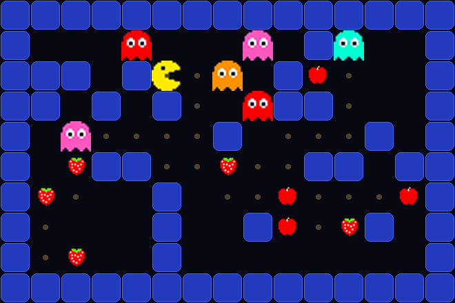

<sub><b>CA1</b> — A* planning a full snack-clearing route through a maze of oscillating ghosts.<br>
The faint trail is the committed plan; every ghost position is replayed from the search, not simulated afterwards.</sub>

<br><br>


</div>

---

## The five projects

| | Project | The problem it solves | Core ideas |
|---|---|---|---|
| **CA1** | [Pac-Man Search](#ca1--pac-man-solved-six-ways) | Clear every snack on a map while ghosts patrol fixed orbits — without ever being caught | Uninformed & informed search, admissible heuristics, state-space design |
| **CA2** | [Genetic Algorithms & Adversarial Games](#ca2--evolution-and-adversaries) | Reassemble a shredded image from its scrambled tiles; play Dots & Boxes well enough to win | Fitness, selection, crossover, mutation · Minimax, alpha–beta pruning |
| **CA3** | [Classical Machine Learning](#ca3--learning-from-labels) | Four supervised tasks: project success, email triage, crisis classification, exam-score regression | Decision trees from scratch, Naive Bayes, bagging & boosting, bias–variance |
| **CA4** | [Neural Networks with PyTorch](#ca4--tensors-gradients-and-a-text-cnn) | Learn the framework from tensors up, then classify Persian food-delivery reviews by sentiment | Autograd, `nn.Module`, training loops, word embeddings, 1-D convolutions |
| **CA5** | [Unsupervised Review Clustering](#ca5--structure-without-labels) | Group 2,732 Amazon food reviews by meaning, with no labels to learn from | Sentence embeddings, K-Means / DBSCAN / hierarchical, PCA & t-SNE, cluster validity |

Each folder holds the original assignment PDF, the implementation, and a written report
answering the assignment's theory questions (CA1 in `report.md`, CA2–CA5 inside the notebooks).
Reports are written in Persian.

---

## CA1 · Pac-Man, Solved Six Ways

<p>     </p>

> Pac-Man must eat every snack on the board. Ghosts oscillate along fixed horizontal or vertical
> tracks, apples must be eaten before strawberries, and touching a ghost — or swapping places with
> one — ends the run. Find the move sequence that clears the board.

**The interesting part is the state.** The obvious choice, "the whole map", is both wrong and
wasteful: two boards that look identical at different times are *not* the same state, because the
ghosts are somewhere else in their cycle. Walls never move, and ghost positions are a pure function
of time. So a state collapses to a triple — Pac-Man's cell, the set of uneaten snacks, and a
phase counter `t mod 24` that pins down where every ghost sits in its cycle. The search space
shrinks dramatically and correctness is restored.

**What's implemented**

- Six solvers behind one interface — **BFS**, **DFS**, **IDS**, **A\***, **Weighted A\***, and a
  *Naive* baseline that simply BFS-hops to the next snack it is allowed to eat, one leg at a time.
- Two admissible, consistent heuristics: a Manhattan-based *snack-priority* estimate that respects
  the apple-before-strawberry rule, and a *remaining-fruits* count.
- Pruning of both collision modes: moving onto a ghost, and the head-on swap that a naive
  position check misses.
- A pygame visualiser with a Player mode and an AI mode that replays the solver's plan frame by
  frame, plus a benchmark harness that tables time / moves / outcome across ten maps.

**Six algorithms, one map** — `map09`, a 30×12 maze with 11 snacks and 10 ghosts:

| Algorithm | Time | Moves | |
|---|---:|---:|---|
| BFS | 103.99 s | 122 | optimal, and pays for it |
| DFS | timeout (30 s) | — | dives down one branch forever |
| IDS | timeout (30 s) | — | BFS's guarantees, DFS's memory, re-expansion cost |
| **A\*** | 73.98 s | **122** | optimal, fewer expansions than BFS |
| **Weighted A\*** | **12.89 s** | 136 | **5.7× faster** for an 11% longer path |
| Naive | 4.25 s | 151 | greedy, one snack at a time — the price is the path |

<sub>Full tables for all ten maps: [`CA1/outputs/`](CA1/outputs/) · reasoning and answers: [`CA1/report.md`](CA1/report.md)</sub>

---

## CA2 · Evolution and Adversaries

<p>   </p>

### Part 1 — Putting a shredded image back together

> An image is cut into a grid of tiles and shuffled. Nothing records where a tile came from.
> Evolve the arrangement back into the original picture.

The fitness signal is purely local: for every pair of neighbouring tiles, measure how badly their
touching edges disagree pixel-by-pixel (the *dissimilarity measure*), then reward arrangements whose
seams vanish. Nothing in the loop ever sees the original image.

<p align="center">
  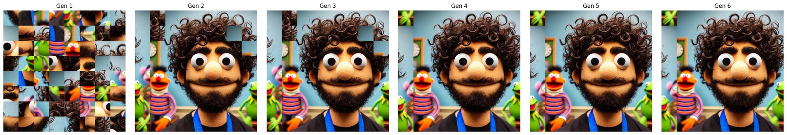
</p>
<p align="center"><sub>Generation 1 is noise. By generation 2 the population has already found most of the picture; the rest is refinement.</sub></p>

<p align="center">
  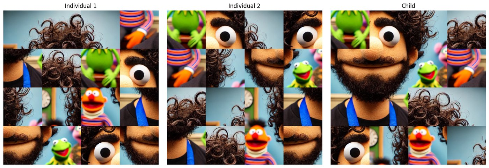
</p>
<p align="center"><sub><b>Crossover is where the design lives.</b> The child grows outward from a seed tile through a priority queue — edges both parents agree on are placed first, then mutually "best buddy" pairs, then the best remaining edge — so inherited structure survives instead of being cut at an arbitrary point.</sub></p>

**Concepts implemented** — chromosome encoding and fitness · roulette-wheel **and** tournament
selection · priority-driven crossover · swap mutation with a decaying rate schedule · elitism ·
convergence detection with patience · a `SizeDetector` that infers the tile grid from the image
alone · hyper-parameter sweeps over population size, elite fraction and mutation rate.

### Part 2 — Dots & Boxes

> Two players alternately draw lines; closing a box scores a point and grants another move.
> Build an agent that plays it well.

<table>
<tr><td width="52%" align="center">
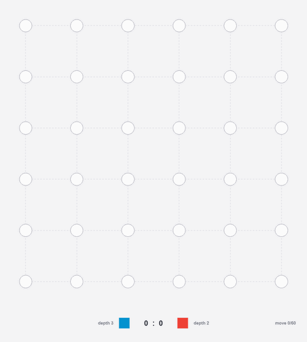
</td><td valign="middle">

Minimax over the full game tree, with **alpha–beta pruning** and a depth limit, handling the rule
that makes this game awkward: closing a box does **not** pass the turn, so a "ply" is not a player
swap and the maximising side can run several moves deep.

Three evaluation functions are compared — a simple score difference, a chain-focused heuristic that
values long capture chains and punishes exposed boxes, and a greedy-swing variant — benchmarked by
win rate across depths, board sizes, and pruning on/off.

<sub>A depth-3 agent (blue) against a depth-2 agent (red) on a 5×5 board, replayed move by move: <b>24–1</b> in 60 moves.<br>Watch the ending — once a chain opens it falls in a burst, because every closed box buys another turn.<br>Widen the gap to depth 5 against depth 1 and the shallower agent scores nothing at all: 16–0.</sub>

</td></tr>
</table>

**Concepts implemented** — game-state representation · minimax · alpha–beta pruning · depth-limited
search with heuristic evaluation · extra-turn game mechanics · an interactive Tkinter board plus a
step-through AI-vs-AI replay viewer.

---

## CA3 · Learning from Labels

<p>    </p>

Four supervised problems, each chosen to expose a different failure mode.

<table>
<tr><td width="56%" align="center">
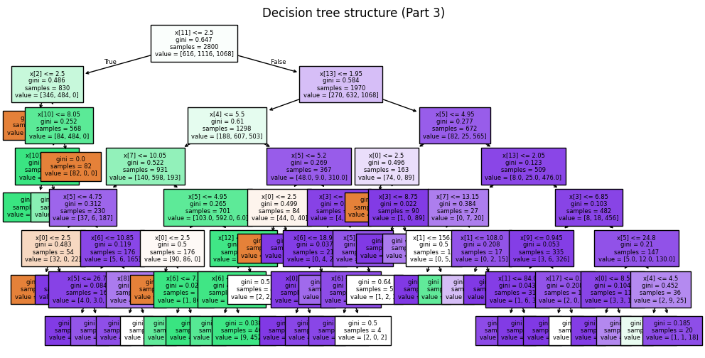
<sub>The tuned tree for the crisis-type task — every node a Gini split, colour showing which class dominates.</sub>
</td><td width="44%" align="center">
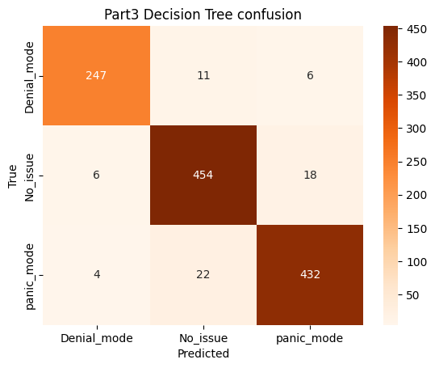
<sub>Where it still gets confused: panic vs. no-issue, almost never denial.</sub>
</td></tr>
</table>

**Part 1 — a decision tree written from scratch.** `MyDecisionTree` implements Gini and entropy
impurity, best-split search over both numeric thresholds and categorical values, depth and
`min_samples` stopping rules, and majority-vote leaves. Scored against scikit-learn on the same
split (0.78 vs 0.84 accuracy), then re-run with one extra feature — `avg_previous_grade` — which
takes the reference tree to 0.95 and makes the point that a single informative feature outweighs a
lot of tuning. A depth-1 stump is included to show how much of the signal lives in the first split.

**Part 2 — email triage.** Bernoulli vs. multinomial Naive Bayes on bag-of-words, against a
decision tree on the same vectors. Naive Bayes wins clearly (0.94 vs 0.75 accuracy) — a reminder
that in high-dimensional sparse text, independence assumptions cost less than greedy axis-aligned
splits do.

**Part 3 — multi-class crisis prediction.** A full pipeline with `ColumnTransformer`
(one-hot + scaling), `GridSearchCV`/`RandomizedSearchCV` tuning, then ensembles: a single tree
reaches 0.94, Random Forest 0.96, AdaBoost only 0.80, and a hand-rolled One-vs-Rest wrapper over
binary trees matches the forest at 0.96.

**Part 4 — regression.** Predicting final exam scores with trees, Random Forest, and XGBoost
(R² = 0.65 / 0.69 / 0.68), closing with a bias–variance probe:

<p align="center">
  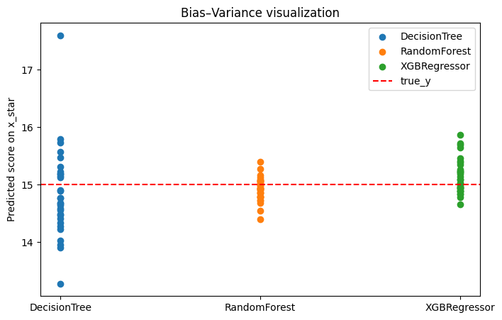
</p>
<p align="center"><sub>One held-out student, predicted by each model refit on 30 random subsamples of the training data (red line = the true score). A single tree scatters across four grade points; averaging many of them collapses that spread without moving the centre.</sub></p>

**Concepts covered** — impurity criteria · overfitting and depth control · the
precision/recall/F1 trade-off · text vectorisation (binary vs. count) · one-vs-rest decomposition ·
bagging vs. boosting · hyper-parameter search · bias–variance decomposition.

---

## CA4 · Tensors, Gradients, and a Text CNN

<p>   </p>

> First build the machinery — tensors, autograd, modules, a training loop — then point it at a real
> problem: 70k Persian food-delivery reviews that need to be sorted into happy and unhappy.

<table>
<tr><td width="42%" align="center">
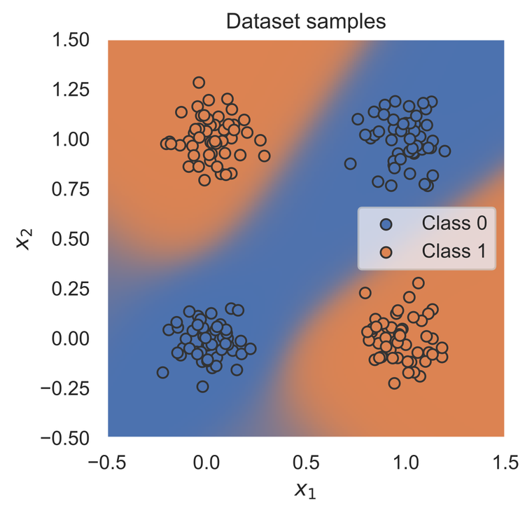
<sub>A two-layer network bending a straight line into the XOR boundary.</sub>
</td><td width="58%" align="center">
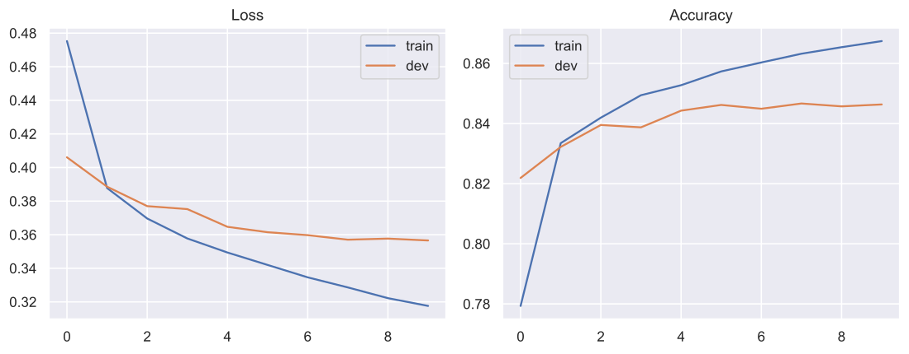
<sub>TextCNN on SnappFood: train and dev separating after epoch 3 — the moment the model starts memorising.</sub>
</td></tr>
</table>

**Part 1 — the framework from the ground up.** Tensor creation and broadcasting, the autograd graph
and `backward()`, CPU-vs-GPU benchmarking, custom `nn.Module` subclasses, `Dataset`/`DataLoader`,
loss modules, an SGD training loop, evaluation under `torch.no_grad()`, checkpointing with
`torch.save`/`load_state_dict`, and a visualisation of the decision boundary a classifier learns on
the XOR dataset.

**Part 2 — sentiment on SnappFood.** Persian text is cleaned and tokenised, embedded with
pre-trained **fastText** vectors (`cc.fa.300`), padded to the 95th-percentile length, and fed to a
**TextCNN**: a 1-D convolution over the embedding sequence, max-pooling, dropout, and a linear
head. Ten epochs, **85.4% test accuracy**, with the confusion matrix and the train/dev gap
reported rather than a single headline number.

**Concepts covered** — automatic differentiation · module composition · mini-batching and
shuffling · over-fitting diagnosis from learning curves · word embeddings as a transfer-learning
layer · convolution as an n-gram detector · padding, pooling, and dropout.

---

## CA5 · Structure Without Labels

<p>    </p>

> 2,732 Amazon food reviews, no labels, no categories. Find the groups that are actually in there —
> and then argue, with metrics, that they are real.

<p align="center">
  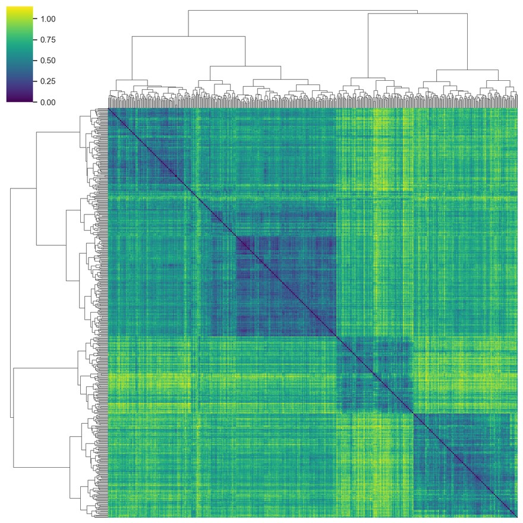
</p>
<p align="center"><sub>A 500-review sample, every review against every other, rows and columns ordered by the Ward dendrogram. The dark blocks on the diagonal <i>are</i> the clusters — structure that falls out of cosine distance alone, with nothing supervising it.</sub></p>

**The pipeline is deliberately modular**, because the question the assignment asks is "which
preprocessing choices matter?" — and that is only answerable if every stage can be swapped:

- **Preprocessing presets** composed from single-purpose functions — unicode normalisation, HTML and
  link stripping, lowercasing, punctuation removal, stopword filtering, then Porter **stemming** or
  POS-aware **lemmatisation** — compared head to head.
- **Feature source flags** — cluster on the review body, the summary line, or the two concatenated.
- **Embeddings** from `all-MiniLM-L6-v2`, turning every review into a 384-dimensional vector where
  distance means semantic similarity rather than shared vocabulary.
- **Tuning that is actually searched**, not guessed: elbow + silhouette sweeps for K-Means, a
  k-distance scan over `eps` × `min_samples` for DBSCAN with noise-ratio and cluster-size guards,
  and linkage checks that reject degenerate single-linkage solutions.
- **Evaluation** on silhouette, Davies–Bouldin, Calinski–Harabasz, plus homogeneity against star
  rating as an external sanity proxy.

<p align="center">
  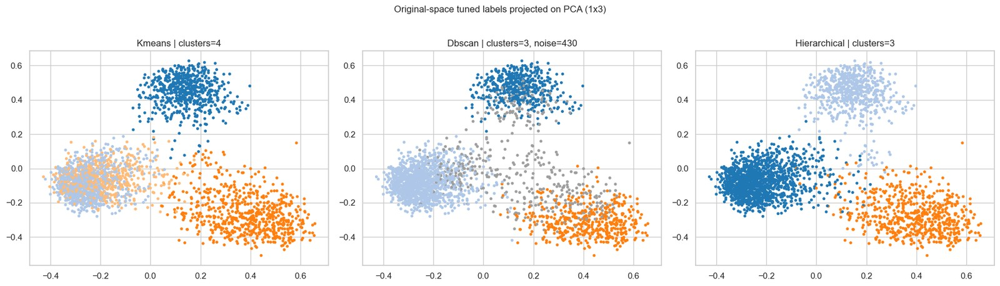
</p>
<p align="center"><sub>The same embedding space, three algorithms. K-Means splits the left blob in two; hierarchical keeps it whole; DBSCAN refuses to label the bridge between them at all (grey = noise) — which is the honest answer where density genuinely falls off.</sub></p>

One number worth reading twice: DBSCAN's silhouette is **0.17** on the raw 384-dimensional
embeddings and **0.75** on the PCA projection of the *same* data. Dimensionality reduction did not
make the clusters better — it changed the space the metric is measured in. The notebook keeps both
and compares before/after rather than quoting the flattering one.

**Concepts covered** — supervised vs. unsupervised framing · bag-of-words → TF-IDF → word vectors →
sentence embeddings · stemming vs. lemmatisation · centroid, density, and linkage-based clustering ·
the elbow method · internal vs. external validity metrics · PCA against t-SNE · reading clusters by
sampling their members.

---

## Running the projects

Everything uses paths relative to its own assignment folder, so run each one from inside it.

```bash
# CA1 — the game. The in-game menu picks Player mode or any of the six solvers, speed, and map.
cd CA1/codes && python main.py

# CA1 — the benchmark harness; prompts for which solvers and which maps to run.
cd CA1/codes && python tester.py          # all six algorithms, any subset of the ten maps
cd CA1/codes && python tester_weighted.py # A* vs Weighted A* (w = 1, 2, 10) across both heuristics

# CA2–CA5 — one notebook each, run top to bottom.
cd CA3 && jupyter lab CA3.ipynb
```

Dependencies are installed by the first cell of each notebook; CA1 needs `pygame`, `pandas` and
`tabulate`. Two large artifacts are intentionally untracked — the fastText Persian vectors
(`CA4/cc.fa.300.bin`, downloaded by the notebook) and the local copy of the sentence-transformer
in `CA5/models/`, which falls back to the Hugging Face hub if absent.

## Layout

```
CA1/  codes/{core/solvers, core/environment, entities}, maps/, outputs/, report.md
CA2/  Report.ipynb · images/ (puzzle sources) · docs/ (game screenshots)
CA3/  CA3.ipynb · *_dataset.csv, *_test.csv, *_predictions.csv
CA4/  Introduction_to_PyTorch.ipynb · snappfood/{train,dev,test}.csv · our_model.tar
CA5/  CA5_project.ipynb · amazon_reviews.csv · stopwords-en.txt · best_labels.csv
```

<div align="center">
<br>
<sub><b>Amir Parsa Mobed</b> · 810100271 · University of Tehran, Fall 2025</sub>
</div>
